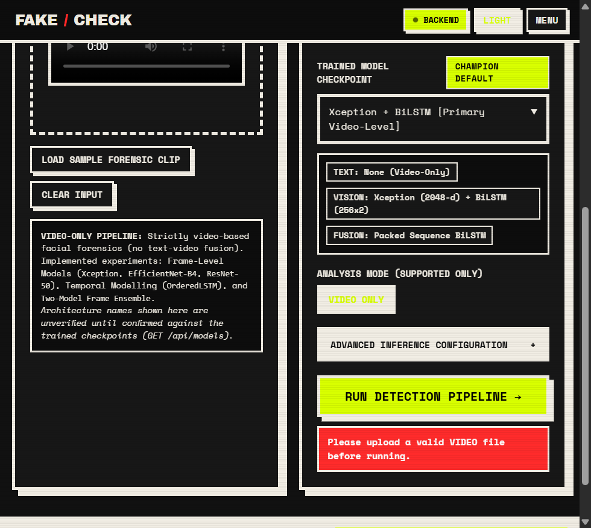
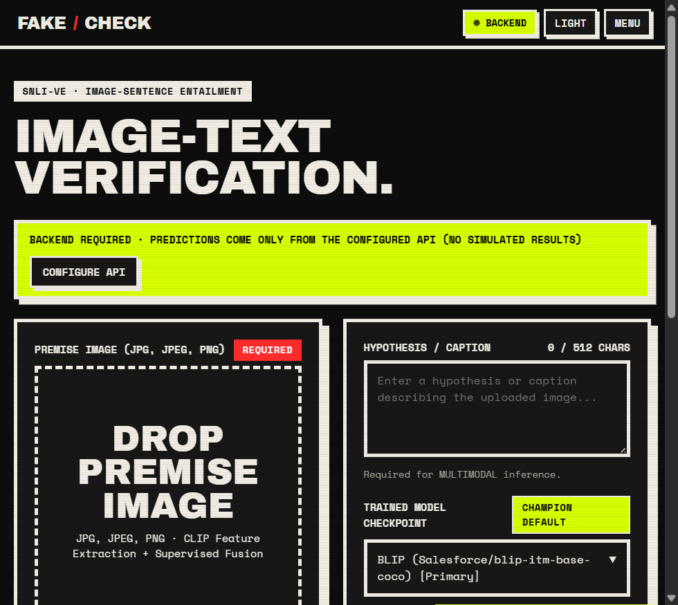
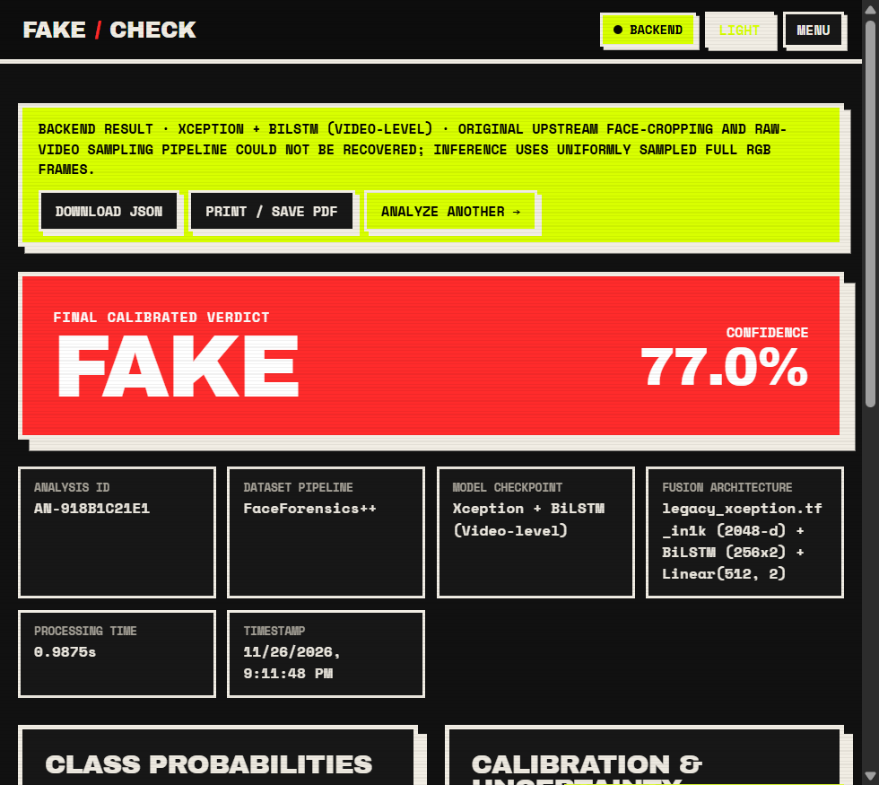

# FakeCheck — Multimodal Content & Manipulation Detection Platform

FakeCheck is a multi-pipeline AI-generated and manipulated content detection platform with a Neo-Brutalist single-file frontend (`frontend/index.html`) served by a FastAPI inference backend (`backend/app/main.py`).

## Screenshots / Application Preview





## Supported Primary Models
1. **Fakeddit (`fk_m3_clip`):** `M3_clip_best.pt` (CLIP ViT-B/16 Dual-Encoder) — binary misinformation classification (`REAL` / `FAKE`) on image + text.
2. **SNLI-VE (`snli_blip`):** `blip-best.pt` (`Salesforce/blip-itm-base-coco`) — 3-class visual entailment (`entailment`, `neutral`, `contradiction`) on image + hypothesis. *(Visual entailment, not deepfake detection.)*
3. **FaceForensics++ (`ff_xception_bilstm`):** `xception_bilstm_video_best.pt` + `Xception_best.pt` (`legacy_xception.tf_in1k` + BiLSTM) — binary video manipulation detection (`REAL` / `FAKE`) on MP4 uploads.

## Architecture & Diagrams
- [System Architecture Diagram](documentation/assets/system-architecture.mmd)
- [Inference Flow Diagram](documentation/assets/inference-flow.mmd)

## Quick Start (Single-Origin Local Development)
```powershell
cd backend
pip install -r requirements.txt
python -m uvicorn app.main:app --host 127.0.0.1 --port 8000
```
Open **`http://127.0.0.1:8000/`** in your browser.

## Model Checkpoints (Not Committed to GitHub)
Large `.pt` checkpoints are excluded via `.gitignore` and must be placed in:
- `models/text/original/fakeddit_leakage_controlled_run/checkpoints/M3_clip_best.pt`
- `models/image/original/SNLI_VE_COMPLETE_PROJECT/blip-best.pt`
- `models/video/original/FFPP_PJ07_FINAL_corrected/checkpoints/xception_bilstm_video_best.pt` & `Xception_best.pt`

## Environment Variables (`backend/.env.example`)
- `FAKECHECK_CORS_ORIGINS`: Comma-separated allowed origins (default: `http://127.0.0.1:5500,http://localhost:5500`).
- `FAKECHECK_MAX_IMAGE_MB`: Max image upload size in MB (default: `15`).
- `FAKECHECK_MAX_VIDEO_MB`: Max MP4 upload size in MB (default: `100`).

## API Endpoints
- `GET /` — Serves `frontend/index.html`.
- `GET /api/health` — Lightweight service & model readiness status.
- `GET /api/benchmark` — Verified CSV evaluation metrics (not directly comparable across different datasets/protocols).
- `POST /api/predict/{fakeddit,snlive,faceforensics}` — Multipart inference endpoints.

## Running Automated Tests
```powershell
cd backend
python -m pytest tests/test_api.py -vv
```

## Limitations & Deployment Notes
- Secondary models remain unimplemented (`HTTP 503`).
- FaceForensics++ uses uniformly sampled full RGB frames because upstream face-cropping was not included in the original training repo.
- Public access via Cloudflare Quick Tunnel (`trycloudflare.com`) is ephemeral and hosted on a local machine, not permanent cloud hosting.

## Documentation
- [Comprehensive Technical Report](documentation/FAKECHECK_COMPREHENSIVE_TECHNICAL_REPORT.md)
- [Deployment Guide](documentation/deployment.md)
- [Backend API Contract](documentation/backend-api-contract.md)
